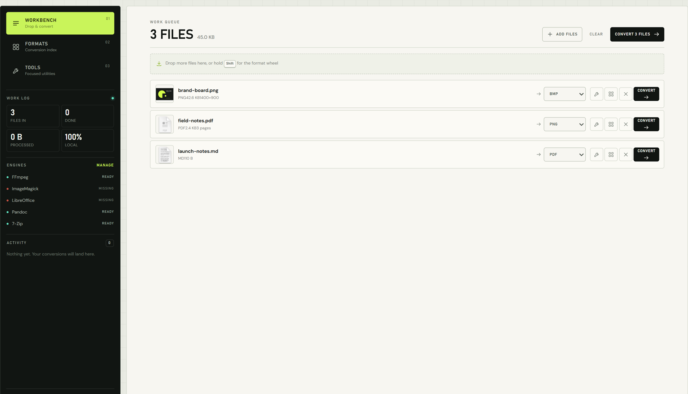
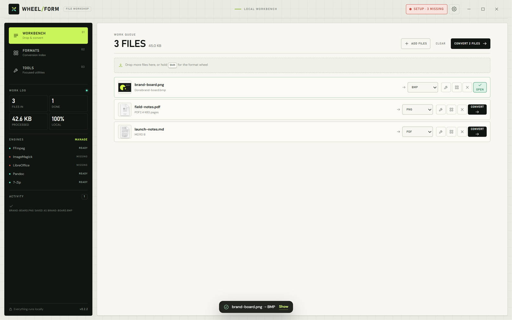
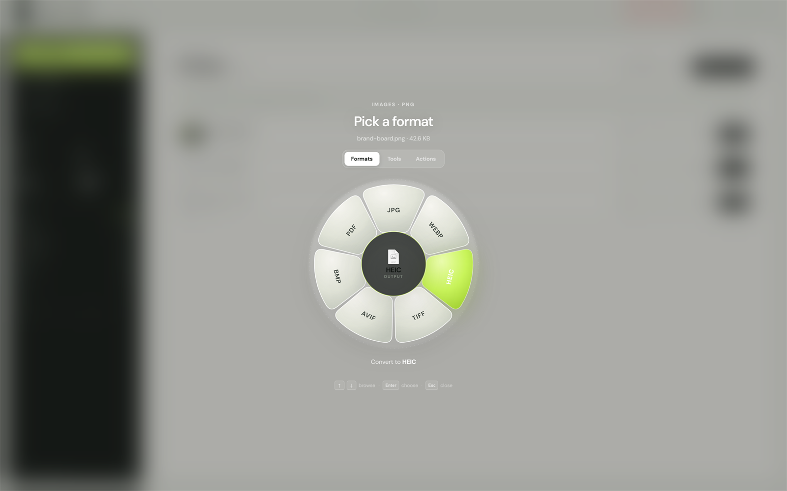
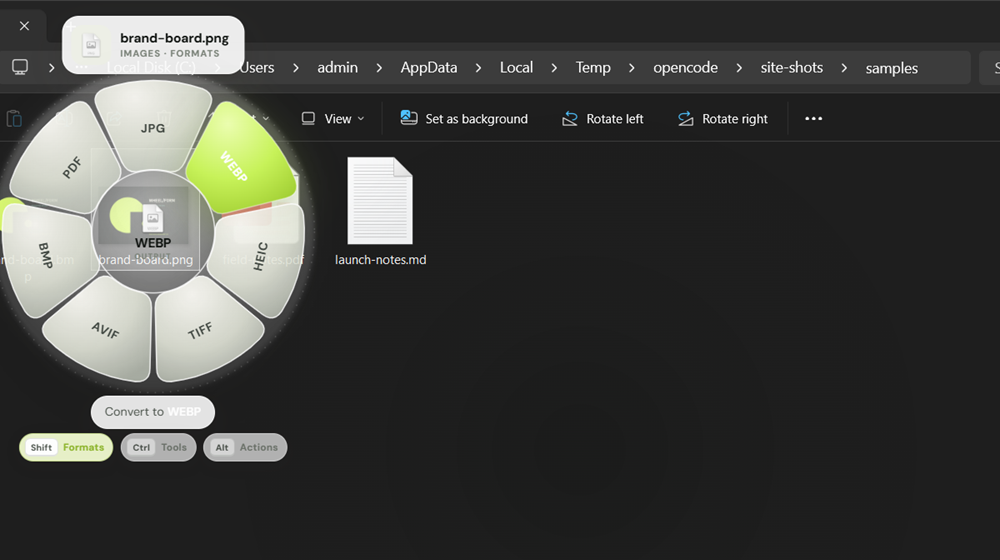
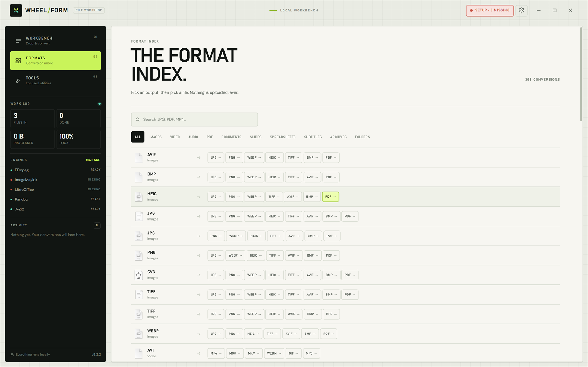
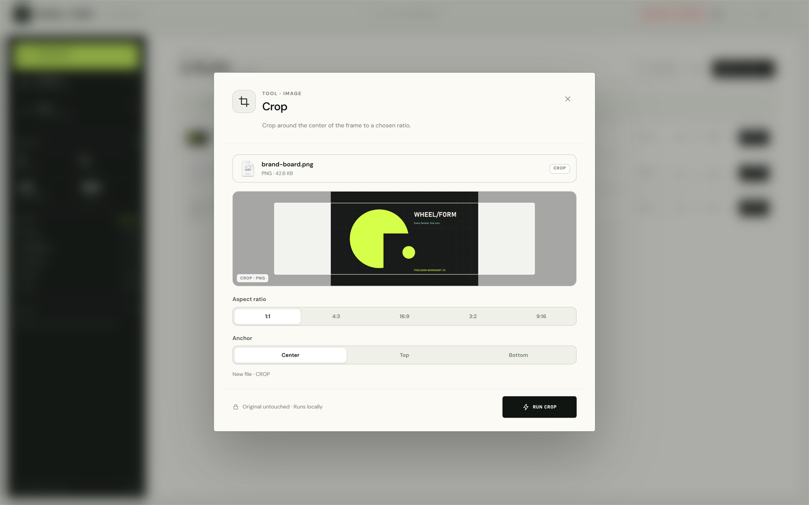
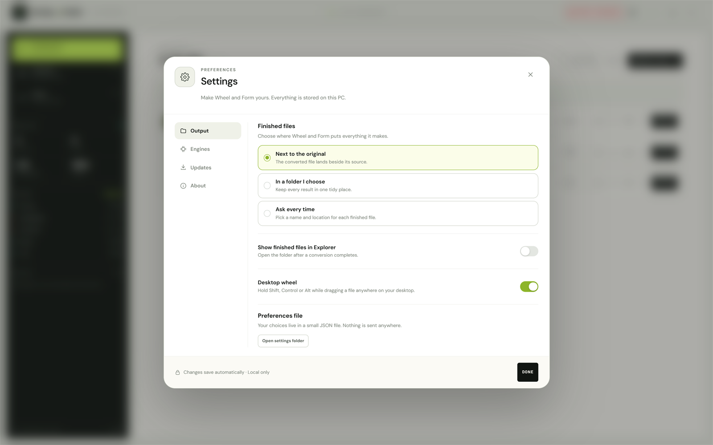
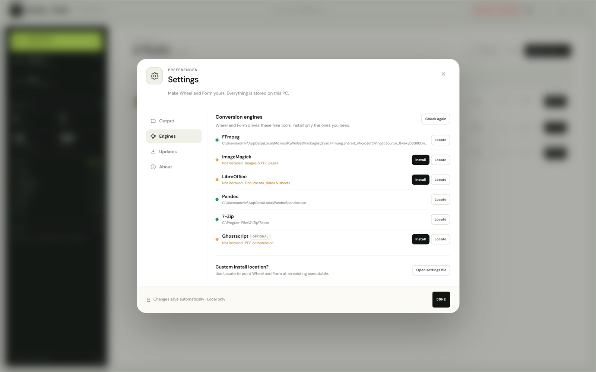

<p align="center">
  
</p>

<h1 align="center">Wheel and Form</h1>

<p align="center">
  <strong>所有格式，一次转动。</strong><br>
  为 Windows 打造的本地优先文件工坊。
</p>

<p align="center">
  <a href="README.md">English</a> ·
  <a href="README.vi.md">Tiếng Việt</a> ·
  <a href="README.ja.md">日本語</a> ·
  <strong>简体中文</strong> ·
  <a href="README.ko.md">한국어</a> ·
  <a href="README.es.md">Español</a> ·
  <a href="README.fr.md">Français</a> ·
  <a href="README.de.md">Deutsch</a>
</p>

<p align="center">
  <a href="https://github.com/Nolane-x/Wheel-and-form/releases/latest"></a>
  
  <a href="LICENSE"></a>
  
  
</p>

<p align="center">
  <a href="https://nolane-x.github.io/Wheel-and-form/"><strong>产品网站&nbsp;&nbsp;↗</strong></a>
  &nbsp;&nbsp;·&nbsp;&nbsp;
  <a href="https://github.com/Nolane-x/Wheel-and-form/releases/latest"><strong>下载 Windows 版&nbsp;&nbsp;↘</strong></a>
  &nbsp;&nbsp;·&nbsp;&nbsp;
  <a href="https://github.com/Nolane-x/Wheel-and-form/releases">版本说明</a>
</p>



Wheel and Form 是一款 Windows 桌面应用，把通常要在五个不同网站之间来回切换的文件任务集中到一处。在本地完成转换、压缩、解压、裁剪、修剪、合并、遮盖和整理。开始拖动文件、按住一个键，然后在径向轮盘上完成操作。无需账号，无需上传，也没有云端队列。

- **303 种转换**，覆盖 **53 种输入格式** 和 **39 种输出格式**
- **26 个专注工具**，面向图片、视频、音频、PDF、文档和压缩包
- **6 种文件操作** — 分享/复制、悬浮预览、创建副本、移动、复制路径、在终端中打开
- **系统级桌面轮盘** — 可直接在资源管理器、桌面或文件对话框中使用，无需打开主应用
- **原生 Windows Shell 集成** — 打开输出位置、打开文件、复制路径，并在文件所在文件夹中启动终端
- **一键更新** — 使用 GitHub 发布校验值验证，重启一次即可完成安装
- **默认本地处理** — 文件的读取和写入都发生在你的电脑上

---

## 工作台

把混合批次排入队列，为每个文件选择目标格式，然后开始转换。输出默认落在源文件旁边，因此你开始处理的那份文件永远不会被移动。每个操作都会写入一个新文件。



- 支持图片、PDF、文档、音频、视频和压缩包的混合队列
- 按文件设置输出位置，而不是只能使用一个全局模式
- 真实进度、清晰错误信息，以及可回看的活动日志
- 无需离开工作台即可打开、定位或分享已完成文件

## 轮盘

轮盘是整个应用以键盘为先的快捷入口。拖动文件时按住修饰键，匹配的目标就会出现在指针下方。

| 按键 | 轮盘 | 显示内容 |
| --- | --- | --- |
| `Shift` | Formats | 该文件可用的输出格式 |
| `Ctrl` | Tools | 适合该文件类型的专注工具 |
| `Alt` | Actions | 分享/复制、预览、创建副本、移动、复制路径、终端 |



在目标上松开即可执行。也可以使用方向键和 `Enter`。轮盘会记住拖动开始的位置，并让工作结果留在原文件旁边。

### 应用之外

同一个轮盘可以在 Windows 的任何位置使用。在资源管理器、桌面或文件对话框中开始拖动文件，然后按住 `Shift`、`Ctrl` 或 `Alt`。轮盘会出现在当前显示器上的指针位置。按 `Escape` 取消。



在应用之外，结果始终写入原文件旁边，源文件永远不会被修改。一张小型状态卡会显示进度，然后让你定位结果，或在缺少引擎时打开引擎设置。

关闭主窗口后，Wheel and Form 会继续在通知区域运行。右键单击托盘图标可以重新打开应用、切换桌面轮盘、打开 Settings 或退出。

---

## 格式

一个持续更新的格式索引，包含 53 种输入格式和 39 种输出格式，按类别整理。可以搜索、筛选，或让轮盘优先显示最可能的目标。



| 类别 | 转换数 | 示例 |
| --- | ---: | --- |
| 图片 | 73 | PNG、JPG、WEBP、HEIC、TIFF、AVIF、BMP、SVG、ICO |
| 视频 | 42 | MP4、MOV、MKV、WEBM、AVI、GIF |
| 音频 | 56 | MP3、M4A、WAV、FLAC、OGG、AAC、OPUS |
| PDF | 9 | PDF → JPG/PNG/TXT/DOCX/PPTX/XLSX，创建 PDF |
| 文档 | 71 | DOCX、PAGES、PDF、TXT、MD、HTML、RTF、ODT |
| 幻灯片 | 6 | PPTX、PPT、PDF、JPG、PNG |
| 电子表格 | 21 | XLSX、XLS、ODS、CSV、TSV、PDF |
| 字幕 | 4 | SRT、VTT、TXT |
| 压缩包 | 20 | ZIP、7Z、TAR、GZIP、重新打包和文件夹归档 |
| 文件夹 | 1 | 文件夹 → ZIP |

## 工具

26 个专注工具，处理最后一步。每个工具都在本地运行，显示结果预览，并保持原文件不变。



Compress · Remove Metadata · Edit Image · Annotate · Add Background · Crop · Redact · Normalize Audio · Mute Video · Trim Video · Split PDF · Organize PDF · Extract Archive · Create PDF · Merge PDFs · Crop Video · Change Speed · Join Videos · Snapshots · Split Video · Audio to Video · Trim Audio · Audio Channels · Bleep Audio · Redact Video · Create Collage

PDF 拆分、合并、整理和创建由进程内的 `pdf-lib` 处理，因此无需外部引擎即可使用。

---

## 默认本地处理

无账号。无上传。无服务器端队列。转换、工具和预览都在你的电脑上运行。设置保存在 Electron 用户数据文件夹中的一个小型 JSON 文件里，不会发送遥测数据。

| 输出设置 | 引擎设置 |
| --- | --- |
|  |  |

Wheel and Form 只在两种情况下发起网络请求：

- 检查 GitHub Releases 是否有应用更新；
- 在你主动要求时，通过 `winget` 安装转换引擎。

更新检查只读取公开的发布元数据。下载内容只包含新的应用构建。不会发送文件名、文件内容、使用数据或个人数据。

## 系统要求与引擎

Wheel and Form 会在运行时检测常见转换引擎。缺少的引擎可以在 **Settings → Engines** 中通过 `winget` 安装，也可以让应用指向已有的可执行文件。

| 引擎 | 用途 | 是否必需？ |
| --- | --- | --- |
| [FFmpeg](https://ffmpeg.org/) | 视频/音频转换、修剪、静音、快照、基础光栅化回退 | 推荐 |
| [ImageMagick](https://imagemagick.org/) | 高级图片编辑、元数据移除、裁剪、注释、遮盖 | 可选 |
| [Pandoc](https://pandoc.org/) | 文本/Markdown/HTML 文档转换 | 可选 |
| [LibreOffice](https://www.libreoffice.org/) | Office 文档转换和 PDF 输出 | 可选 |
| [7-Zip](https://www.7-zip.org/) | 创建和解压压缩包 | 可选 |
| [Ghostscript](https://www.ghostscript.com/) | PDF 光栅化和 PDF 文本提取 | 可选 |

PDF 工具开箱即用。没有 ImageMagick 时，常见光栅格式（PNG/JPG/WEBP/TIFF/GIF）会回退到 FFmpeg。

## 安装

1. 打开[最新版本](https://github.com/Nolane-x/Wheel-and-form/releases/latest)。
2. 下载 `Wheel-and-Form-Setup-<version>.exe`。
3. 运行安装程序并选择目标文件夹。按用户安装，不需要管理员账户。

安装程序没有代码签名，因此 Windows SmartScreen 可能会在首次启动时要求确认。

## 更新

已安装版本会在启动时以及每六小时检查一次 GitHub Releases。发现新版本后，标题栏和 **Settings → Updates** 会显示提示。可以在那里下载并重启。

更新会使用发布校验值验证，并且不会改动你的文件或偏好设置。也可以在 **Settings → Updates** 中手动检查。

## 开发

```bash
npm install
npm start
```

常用检查：

```bash
node --check electron/main.js
powershell -ExecutionPolicy Bypass -File native/build.ps1
npm run build:win
```

桌面轮盘使用一个小型原生辅助程序。它检测全局拖动并拥有原生 OLE 放置目标；Electron 只负责在最上层绘制轮盘。`native/build.ps1` 使用 Windows 自带的 .NET Framework 编译器构建它；生成的可执行文件会自动复制到安装程序中。

## 构建 Windows 安装程序

```bash
npm run build:win
```

输出写入 `dist/`：

- `Wheel-and-Form-Setup-<version>.exe` — NSIS 安装程序
- `latest.yml` 和 blockmap — 已安装版本使用的更新元数据
- 解包后的应用文件，便于本地检查

一步构建并发布到 GitHub：

```powershell
$env:GH_TOKEN = "github-token-with-repo-scope"
npm run release:win
```

`.github/workflows/build.yml` 中的 GitHub Actions 工作流会在 `windows-latest` 上构建相同的安装程序，并作为 artifact 上传。

## 项目结构

```text
electron/
  main.js                  Electron 窗口、托盘、IPC、文件和转换任务
  desktop.js               桌面覆盖层、状态卡、原生拖动辅助程序
  preload.js               安全的 window.api 桥接
  settings.js              JSON 偏好设置
  updater.js               GitHub 版本检查、下载状态和安装交接
  converter/
    registry.js            转换、工具和操作定义
    engine.js              引擎发现和进程执行
    pdf.js                 基于 pdf-lib 的 PDF 工具
    subtitle.js            字幕辅助函数
src/
  index.html               应用外壳
  styles.css               Precision Workshop 设计系统、外壳、视图和队列
  styles-wheel.css         径向轮盘和桌面覆盖层
  styles-modal.css         设置和工具对话框
  app.js                   队列、视图、统计和活动
  interactions.js          轮盘、拖放、操作和键盘
  wheel.js                 径向轮盘几何和渲染
  desktop.html/css/js      透明的系统级轮盘覆盖层
  desktop-status.*         进度和结果卡
  settings.js              设置、引擎安装和更新状态
  update.js                标题栏更新胶囊、提示和一键操作
  toolmodal.js             工具选项和预览
  float.js                 悬浮预览窗口
native/
  WheelAndFormDragHook.cs  原生拖动检测器和 OLE 放置目标
  build.ps1                使用 Windows .NET 编译器构建辅助程序
site/                      静态产品网站，由 GitHub Pages 部署
assets/                    应用图标、品牌标记和字体
```

## 产品网站

静态网站位于 [`site/`](site/)，由 `.github/workflows/deploy-pages.yml` 部署。它使用相同的 Precision Workshop 设计系统、真实应用截图，以及英语、越南语、日语、简体中文、韩语、西班牙语、法语和德语八种文案。

本地预览：

```bash
python -m http.server 8123 --directory site
```

然后打开 `http://127.0.0.1:8123/`。

## 许可证

MIT。参见 [LICENSE](LICENSE)。Wheel and Form 是一款独立的 Windows 应用程序。

---

<p align="center">
  <a href="README.md">English</a> ·
  <a href="README.vi.md">Tiếng Việt</a> ·
  <a href="README.ja.md">日本語</a> ·
  <strong>简体中文</strong> ·
  <a href="README.ko.md">한국어</a> ·
  <a href="README.es.md">Español</a> ·
  <a href="README.fr.md">Français</a> ·
  <a href="README.de.md">Deutsch</a> ·
  <a href="https://github.com/Nolane-x/Wheel-and-form">GitHub</a>
</p>
